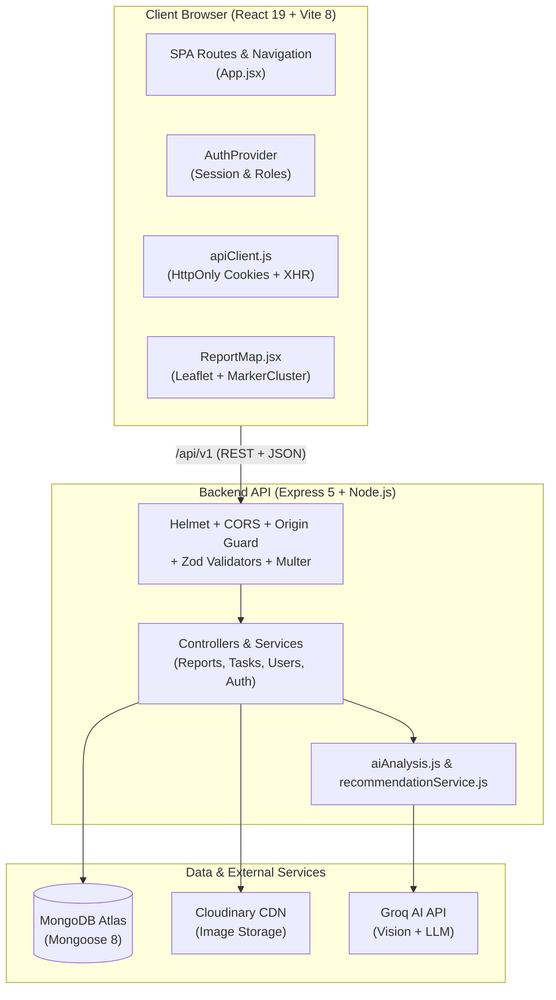
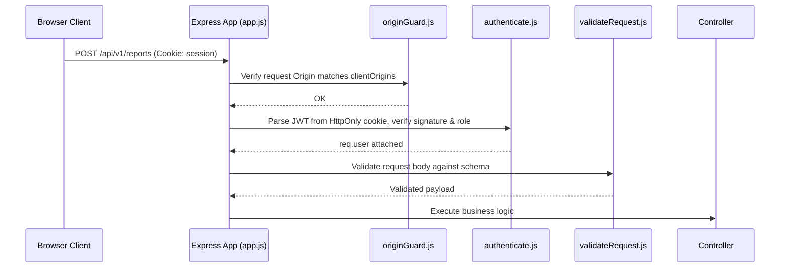

# SwachhAI — Codebase Reading Plan & Architectural Guide

Welcome to the **SwachhAI** codebase! SwachhAI is an enterprise-grade civic reporting, AI-assisted triage, and municipal workforce dispatch platform designed for campus and urban management (piloted at NIT Patna).

This guide provides a structured, progressive **6-phase reading roadmap** for developers and researchers exploring the codebase. Following this order ensures you build a solid mental model—starting from high-level architecture down to data models, security middleware, the three core user workflows (Citizen, Worker, Admin), AI services, and testing suites.

---

## 🗺️ System Architecture at a Glance

---

## ⏱️ Reading Roadmap Overview

| Phase | Focus Area | Key Modules | Suggested Time |
|---|---|---|---|
| **Phase 0** | System Orientation & Setup | Documentation, configs, script runners | ~30 min |
| **Phase 1** | Domain Entities & State Machines | Mongoose schemas & status transitions | ~45 min |
| **Phase 2** | Security & Request Lifecycle | Middleware, auth, origin guards, API client | ~45 min |
| **Phase 3** | The Three User Workflows | Citizen, Admin, and Field Worker journeys | ~2 hours |
| **Phase 4** | AI & Advisory Subsystems | Groq vision, signed tokens, recommendations | ~1 hour |
| **Phase 5** | Frontend Architecture & Visuals | Routing, layouts, design tokens, maps | ~45 min |
| **Phase 6** | Verification & Test Suites | Node test runner, Vitest suites | ~30 min |

---

## Phase 0: System Orientation & Configuration (Skim First)

**Goal:** Understand the project's purpose, boundaries, and how it executes locally.

### Key Files:
1. [`README.md`](../README.md)
   - *Focus:* Skim the feature map and high-level architecture.
2. [`docs/architecture.md`](architecture.md)
   - *Focus:* Notice the dependency-injected design, origin guard rules, and Cloudinary upload safeguards.
3. [`package.json`](../package.json) & [`server/package.json`](../server/package.json)
   - *Focus:* Key dependencies: React 19, React Router 7, Tailwind 4, Express 5, Mongoose 8, Zod, Multer, Leaflet.
4. [`server/src/config/env.js`](../server/src/config/env.js)
   - *Focus:* Environment validation and required secrets (`JWT_SECRET`, `GROQ_API_KEY`, `CLOUDINARY_*`).
5. [`vite.config.js`](../vite.config.js)
   - *Focus:* How the Vite development server proxies `/api/v1` to the backend on port `5000`.

---

## Phase 1: Domain Entities & Data Modeling

**Goal:** Understand the entities stored in MongoDB and the strict state machines governing their lifecycles.

### Key Files:
1. [`server/src/models/User.js`](../server/src/models/User.js)
   - *Focus:* Roles (`citizen`, `worker`, `admin`), `approvalStatus` (`active`, `pending_approval`, `rejected`), and bcrypt password hashing.
2. [`server/src/models/Report.js`](../server/src/models/Report.js) *(Most critical model)*
   - *Focus:* 
     - Sequential `reportNumber` counter (`SW-XXXXXX`).
     - GeoJSON `[longitude, latitude]` with a `2dsphere` index.
     - `statusHistory` array capturing transition events, timestamps, and actors.
     - Status enum: `submitted`, `under_review`, `assigned`, `in_progress`, `submitted_for_verification`, `resolved`, `rejected`, `duplicate`, `reopened`.
3. [`docs/reports.md`](reports.md)
   - *Focus:* Directed state transition table. Who can trigger which transition?
4. [`server/src/models/Zone.js`](../server/src/models/Zone.js)
   - *Focus:* Campus pilot zones (NIT More, Ashok Rajpath, Gandhi Ghat), approximate centers, radius, and polygon boundaries.
5. [`server/src/models/AuditLog.js`](../server/src/models/AuditLog.js) & [`server/src/models/Notification.js`](../server/src/models/Notification.js)
   - *Focus:* Append-only administrative audits and deduplicated notification delivery (`recipient`, `eventKey`).
6. [`server/src/models/Recommendation.js`](../server/src/models/Recommendation.js)
   - *Focus:* Periodic aggregate cleanliness snapshots for AI analysis.

---

## Phase 2: Request Lifecycle & Security Foundations

**Goal:** Trace how incoming HTTP requests are authenticated, checked against CSRF/Origin attacks, validated, and processed.

### Key Files:
1. [`server/src/app.js`](../server/src/app.js)
   - *Focus:* Dependency injection pattern (`createApp({ config, UserModel, ... })`), Helmet, CORS, and request body limits.
2. [`server/src/middleware/originGuard.js`](../server/src/middleware/originGuard.js)
   - *Focus:* Strict CSRF defense verifying the `Origin` header on state-modifying requests (`POST`, `PATCH`, `DELETE`).
3. [`server/src/middleware/authenticate.js`](../server/src/middleware/authenticate.js)
   - *Focus:* Extracting JWT from HttpOnly cookies and role check guards (`authorizeRole('admin')`).
4. [`server/src/middleware/validateRequest.js`](../server/src/middleware/validateRequest.js) & [`server/src/validators/reportValidators.js`](../server/src/validators/reportValidators.js)
   - *Focus:* Zod schemas validating request bodies before controllers execute.
5. [`server/src/middleware/reportUpload.js`](../server/src/middleware/reportUpload.js)
   - *Focus:* Multer memory storage and file signature verification using `file-type` to prevent extension spoofing.
6. [`src/services/apiClient.js`](../src/services/apiClient.js)
   - *Focus:* Frontend `fetch` wrapper: credentials handling (`include`), JSON parsing, and XHR fallback for multipart upload progress.
7. [`src/features/auth/AuthProvider.jsx`](../src/features/auth/AuthProvider.jsx) & [`src/components/auth/ProtectedRoute.jsx`](../src/components/auth/ProtectedRoute.jsx)
   - *Focus:* How the React client restores user sessions on boot and guards routes based on roles.

---

## Phase 3: The Three Core User Workflows (Follow the Data)

Trace the three core journeys end-to-end, pairing frontend pages with backend controllers.

### 3A. The Citizen Journey (Report & Track)
A citizen snaps a waste photo, AI analyzes it, the zone is geofenced, and the complaint is submitted.

1. **Frontend Report Form:**
   - [`src/pages/ReportFormPage.jsx`](../src/pages/ReportFormPage.jsx)
     - Multi-step form: image capture, AI classification trigger, GPS/map coordinate picker.
   - [`src/features/reports/zoneMatching.js`](../src/features/reports/zoneMatching.js)
     - Haversine distance matching coordinates against configured pilot zone circles.
   - [`src/features/reports/reportService.js`](../src/features/reports/reportService.js)
     - Sending multipart payload with signed AI analysis token.
2. **Backend Submission & Storage:**
   - [`server/src/routes/reportRoutes.js`](../server/src/routes/reportRoutes.js) (`POST /`)
   - [`server/src/controllers/reportController.js`](../server/src/controllers/reportController.js) (`createReport`)
   - [`server/src/services/imageStorage.js`](../server/src/services/imageStorage.js)
     - Cloudinary upload and rollback cleanup if database save fails.
3. **Citizen Dashboard & History:**
   - [`src/pages/CitizenDashboardPage.jsx`](../src/pages/CitizenDashboardPage.jsx)
   - [`src/pages/MyReportsPage.jsx`](../src/pages/MyReportsPage.jsx)
   - [`src/pages/ReportDetailPage.jsx`](../src/pages/ReportDetailPage.jsx)
     - View timeline events and status badges.

---

### 3B. The Admin Operations Journey (Triage, Dispatch & Analytics)
Administrators review incoming complaints, link duplicates, dispatch workers, and monitor campus metrics.

1. **Operations Dashboard & Metrics:**
   - [`src/pages/AdminDashboardPage.jsx`](../src/pages/AdminDashboardPage.jsx)
     - Metric cards, daily volume bar charts, zone distribution.
   - [`server/src/controllers/reportController.js`](../server/src/controllers/reportController.js) (`adminMetrics`, `recentAudit`)
     - MongoDB `$group` and `$dateToString` aggregation pipelines.
2. **Moderation & Worker Dispatch Queue:**
   - [`src/pages/AdminTaskPage.jsx`](../src/pages/AdminTaskPage.jsx)
     - Triage interface: modify category/priority, assign worker, set due dates, link duplicates.
   - [`server/src/controllers/taskController.js`](../server/src/controllers/taskController.js) (`assign`, `verify`, `returnTask`)
   - [`server/src/services/taskService.js`](../server/src/services/taskService.js)
     - Validates role transitions and records audit logs.
3. **Zone Boundaries & Worker Roster:**
   - [`src/pages/AdminZonesPage.jsx`](../src/pages/AdminZonesPage.jsx) & [`AdminWorkersPage.jsx`](../src/pages/AdminWorkersPage.jsx)
   - [`src/pages/AdminAccessRequestsPage.jsx`](../src/pages/AdminAccessRequestsPage.jsx)
     - Approving worker or admin signups.

---

### 3C. The Field Worker Journey (Accept, Execute & Proof)
Sanitary personnel accept jobs on campus, log field progress, upload completion photos, and submit for sign-off.

1. **Worker Task Queue & Screen:**
   - [`src/pages/WorkerDashboardPage.jsx`](../src/pages/WorkerDashboardPage.jsx)
     - Task list with urgency chips, deadlines, and assigned zones.
   - [`src/pages/WorkerTaskPage.jsx`](../src/pages/WorkerTaskPage.jsx)
     - Action buttons: "Accept Task", "Add Note", "Upload Proof Photo", "Submit for Verification".
2. **Backend Task Lifecycle:**
   - [`server/src/routes/taskRoutes.js`](../server/src/routes/taskRoutes.js)
   - [`server/src/controllers/taskController.js`](../server/src/controllers/taskController.js) (`accept`, `notes`, `evidence`, `submit`)
   - [`docs/worker-tasks.md`](worker-tasks.md)
     - Explains the state flow: `assigned` → `in_progress` → `submitted_for_verification` → `resolved` (or `returned`).

---

## Phase 4: AI & Advisory Subsystems

**Goal:** Understand how external LLM/Vision APIs (Groq) are safely integrated without risking data integrity or privacy.

### Key Files:
1. **Vision Classification & Signed Tokens:**
   - [`server/src/services/aiAnalysis.js`](../server/src/services/aiAnalysis.js)
     - Groq vision API integration (Qwen/Llama vision models).
     - **Key Security Detail:** Notice the HMAC-SHA256 signature generated over the AI prediction. This prevents the client from tampering with the AI's category recommendation between classification and report submission.
2. **Evidence-Based Recommendations:**
   - [`server/src/services/recommendationService.js`](../server/src/services/recommendationService.js)
     - Notice that Groq receives **only aggregated counts** (never citizen names or personal info).
     - The backend validates that model outputs strictly match observed evidence (rejecting hallucinated statistics).
   - [`src/features/recommendations/recommendationService.js`](../src/features/recommendations/recommendationService.js)
3. **Civic Assistant Chatbot:**
   - [`server/src/controllers/assistantController.js`](../server/src/controllers/assistantController.js)
     - Privacy filter: queries asking for report status are resolved directly via database lookup, **bypassing the LLM entirely**.
   - [`src/pages/AssistantPage.jsx`](../src/pages/AssistantPage.jsx)
     - Natural language complaint drafting that populates the report form.

---

## Phase 5: Frontend Architecture, Navigation & Visuals

**Goal:** Understand the UI architecture, routing layouts, design tokens, and map rendering.

### Key Files:
1. **Application Entry & Routing:**
   - [`src/main.jsx`](../src/main.jsx)
   - [`src/app/App.jsx`](../src/app/App.jsx)
     - Notice how routes are split into three role branches: `/app` (citizen), `/worker`, and `/admin`.
2. **Layout Wrappers:**
   - [`src/layouts/AppLayout.jsx`](../src/layouts/AppLayout.jsx) (Sidebar navigation, active role selector, topbar)
   - [`src/layouts/PublicLayout.jsx`](../src/layouts/PublicLayout.jsx) (Navbar, landing pages, footer)
3. **Geospatial & Map Integration:**
   - [`src/features/map/ReportMap.jsx`](../src/features/map/ReportMap.jsx)
     - Leaflet integration, OpenStreetMap tiles, MarkerCluster group, custom SVG pin markers.
   - [`src/pages/ReportMapPage.jsx`](../src/pages/ReportMapPage.jsx)
     - Scoped pins: citizens see only their reports; workers see assigned tasks; admins see everything.
4. **Design System & Tokens:**
   - [`src/theme.css`](../src/theme.css) (CSS variables for light/dark mode, status colors)
   - [`src/features/theme/ThemeProvider.jsx`](../src/features/theme/ThemeProvider.jsx) (`data-theme` attribute management)

---

## Phase 6: Verification & Test Suites

**Goal:** Read tests to see how the system is verified and understand edge cases.

### Key Files:
1. **Backend Integration Tests:**
   - [`server/test/auth.test.js`](../server/test/auth.test.js) (Registration, cookie flags, origin blocking)
   - [`server/test/reports.test.js`](../server/test/reports.test.js) (Report creation, status transitions, 404 ownership checks)
   - [`server/test/tasks.test.js`](../server/test/tasks.test.js) (Worker assignments, proof uploads, admin verification)
   - [`server/test/aiAnalysis.test.js`](../server/test/aiAnalysis.test.js) (Token signing & verification)
2. **Frontend Unit Tests:**
   - [`src/features/reports/reports.test.jsx`](../src/features/reports/reports.test.jsx)
   - [`src/features/reports/zoneMatching.test.js`](../src/features/reports/zoneMatching.test.js)

---

## 🎯 Active Reading Checkpoints

Test your knowledge after reading each phase:

- [ ] **Checkpoint 1 (Data):** What happens if a citizen submits a report with an assigned worker ID or a custom status? *(Hint: Look at `Report.js` and `reportValidators.js`).*
- [ ] **Checkpoint 2 (Security):** Why does `originGuard.js` reject a request if the `Origin` header doesn't match `clientOrigins` even if the JWT cookie is valid? *(Hint: CSRF).*
- [ ] **Checkpoint 3 (Worker):** Can a worker approve their own task resolution without an administrator's review? *(Hint: Look at `taskController.js` and `taskService.js`).*
- [ ] **Checkpoint 4 (AI):** How does SwachhAI prevent users from fabricating AI confidence scores in the frontend? *(Hint: Check `aiAnalysis.js` token signing).*
- [ ] **Checkpoint 5 (Maps):** Why does `ReportMapPage` show different pins depending on whether the logged-in user is a Citizen, Worker, or Admin? *(Hint: Check `/reports/map` in `reportController.js`).*

---

## 🚀 Recommended Next Step
Start with **Phase 0** and **Phase 1** by opening [`server/src/models/Report.js`](../server/src/models/Report.js) alongside [`docs/reports.md`](reports.md).
