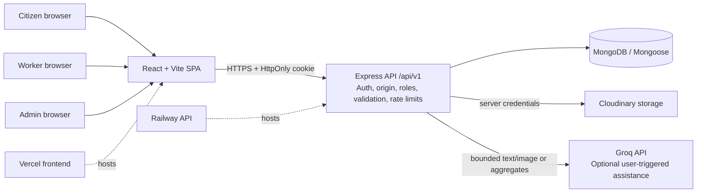
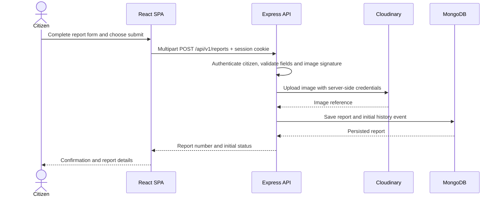
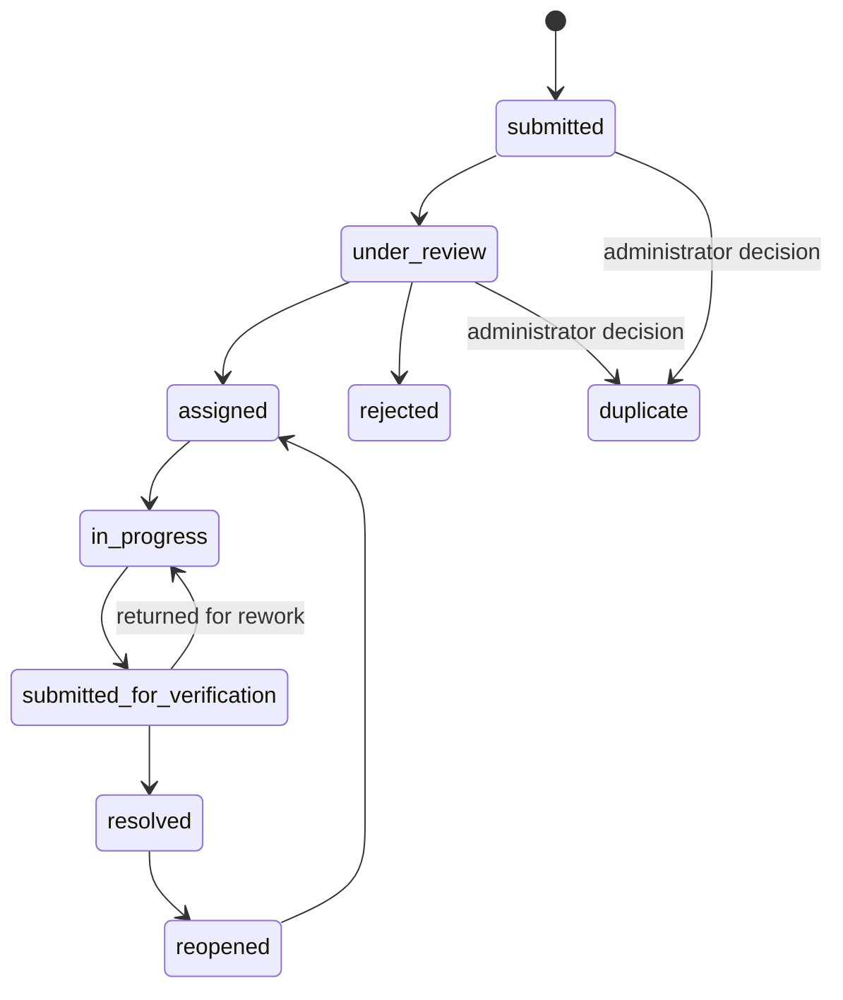

# SwachhAI system diagrams

These diagrams describe the inspected source architecture. Update them if the deployed project differs.

## Component and trust-boundary diagram



## Citizen report sequence



## Recommendation review sequence

```mermaid
sequenceDiagram
  actor Admin
  participant UI as Admin dashboard
  participant API as Express API
  participant DB as MongoDB
  participant AI as Groq
  Admin->>UI: Request recommendations
  UI->>API: POST /api/v1/recommendations/admin/generate
  API->>API: Verify admin and filters
  API->>DB: Aggregate report counts and evidence
  DB-->>API: Aggregate snapshot
  alt At least three reports
    API->>AI: Period labels and aggregate evidence only
    AI-->>API: Structured suggested text and evidence keys
    API->>API: Validate schema and bind keys to real evidence
  else Sparse data
    API->>API: Save insufficient-evidence snapshot; skip AI
  end
  API->>DB: Save run for human review
  API-->>UI: Evidence and recommendation history
  Admin->>UI: Review/accept/reject/record action
  UI->>API: PATCH review
  API->>DB: Save review and audit event
```

## Report status lifecycle



The exact allowed transitions are enforced by backend service logic. Check `server/src` before changing the diagram. `duplicate` is an administrative classification; it does not delete a report.
